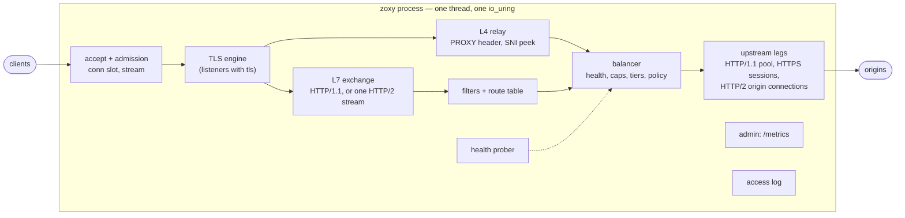
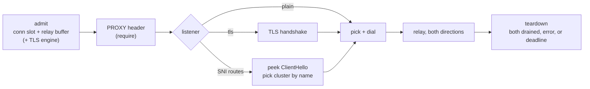
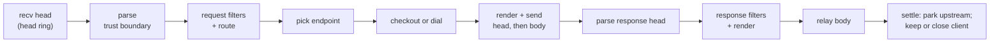
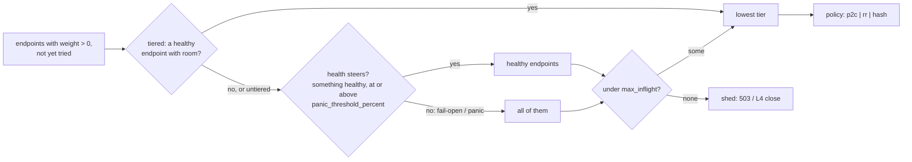
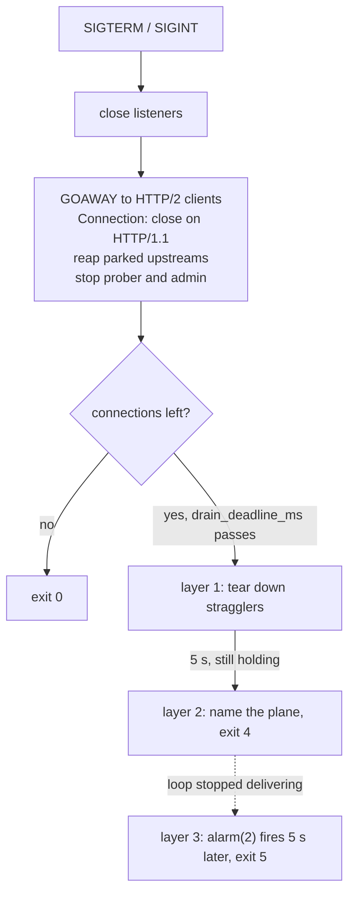

# zoxy — design

zoxy is an L4/L7 proxy in Zig 0.17 built on two hard constraints:

- **Nothing allocates after startup.** Every byte zoxy holds is reserved
  when the process starts. Its size is a closed-form function of
  `src/constants.zig` and the loaded config, and the startup banner
  prints it.
- **Exhaustion sheds load.** When a resource runs out, the newest work
  gets a defined answer at a defined point. Nothing crashes, queues
  without bound, blocks, or allocates.

This document is the design as it stands at 1.0: what each mechanism does
and why it has that shape. Code cites sections as a bare `§N`, and each
number keeps its topic. Other documents cover the rest:

- coding rules: [TIGER_STYLE.md](TIGER_STYLE.md);
- the operator's manual: [README.md](README.md);
- planned work: GitHub issues.

| § | topic |
|---|---|
| 1 | goals and non-goals |
| 2 | the shape at a glance |
| 3 | topology: one thread, one loop, one ring |
| 4 | the I/O seam and TLS |
| 5 | memory, budgets and the config |
| 6 | the L4 data path |
| 7 | the L7 data path |
| 8 | load shedding and observability |
| 9 | testing |
| 10 | module map |
| 11 | references |
| 12 | conformance |
| 13 | embedding |

## 1. Goals and non-goals

Goals, in priority order:

1. **Bullet-proof.** No crash, no OOM, no unbounded queue. Every
   resource has a static limit. Reaching it sheds load at a fixed point
   with a fixed answer (§8).
2. **Zero allocation after startup.** All memory is reserved at init,
   and gates enforce it rather than hope for it (§9).
3. **Small memory.** Pools are shared and sized for concurrent
   *activity*, not for open connections multiplied by cores (§5).
4. **Simplicity.** One thread, one event loop, one ring, one writer per
   pool (§3). Extension happens at compile time, not through runtime
   hooks (§13).
5. **The serving surface:**
   - an L4 TCP relay (§6);
   - an HTTP/1.1 reverse proxy that HTTP/2 clients also reach (§7);
   - origins spoken to over HTTP/1.1, HTTPS, h2c and h2, with gRPC
     carried, trailers included;
   - TLS 1.3 terminated and originated (§4).

Non-goals. Each is recorded so that it reads as a decision, not as drift:

- **HTTP/3.**
- **Caching, compression, body transformation.** Header edits and path
  prefix rewrites are filters (§7). Bodies pass through untouched.
- **Envoy or nginx parity, or runtime plugins.** That includes
  scripting and WASM: an interpreter cannot pass the zero-allocation
  gate. Programmability means a Zig function added at compile time.
- **Worker threads and cross-thread queues.** CPU scale-out is more
  processes (§3).
- **Config reload.** The config is parsed once, and a change means a
  restart. SIGHUP only reopens the access log's file (§8).
- **DNS, and discovery at runtime.** zoxy resolves no name: an
  endpoint is an IP address or a `unix:` path in the options. A build
  that finds its endpoints — in DNS, or in a registry — does so in its
  own code before the options exist (§13), and the set is fixed for the
  process's life.
- **xDS, multi-process orchestration, hot restart.**
- **Production off Linux.** Production means Linux with io_uring.
  macOS builds ship for development, and correctness claims are made
  for Linux only.

## 2. The shape at a glance

One process, one thread, one io_uring. Everything below runs on that
thread.



Each part's section:

- how a connection is admitted and what it holds: §5;
- the L4 relay: §6;
- the L7 exchange, routing, filters, the balancer and health: §7;
- what happens when something runs out: §8.

## 3. Topology — one thread, one loop, one ring

**The decision.** One thread owns the single io_uring (through libxev),
every pool, and all the work. That includes accepts, socket I/O, timers,
TLS handshakes, health probes, admin scrapes and the access log. There
are no other threads, and no queues between threads.

What that buys:

- **Single-writer pools by construction.** No locks, atomics or padded
  cache lines on the data path; counters are plain `u64` (§8).
- **Memory follows activity.** One pool sized for the whole process
  replaces per-core pools each sized for its own worst case.
- **Maximal upstream reuse.** Every pooled origin connection is visible
  to every request, with no synchronization.
- **One admission point.** Every shed decision sees every pool
  consistently. There are no per-worker budgets summing to surprises.
- **Determinism.** Completions have one order, so the simulator replays
  a seed exactly (§9).

**Scale-out is processes.** Run N independent zoxy processes behind
`SO_REUSEPORT`, one per core or one per NUMA node with pools faulted
node-local. Upstream reuse is then per process. Hash and cookie
stickiness still agree across processes because both are stateless
(§7). A `unix:` listener binds its path once, so it does not spread
across processes.

**Handshake CPU.** Signing occupies the loop until the signature is
ready. An RSA signature can take milliseconds, so certificate selection
prefers ECDSA among compatible keys within the same name tier (§4).
`tls_rsa_signed` counts completed handshakes that used RSA. Session
resumption reduces how often signatures are needed. Additional
processes provide more capacity for full handshakes.

## 4. I/O and TLS — the seams

### Dependencies

Each dependency is a zoxy-io repository: forks, plus zssl, which was
written for zoxy. Each is pinned by content hash in `build.zig.zon` to an
audited commit, and a pin moves only after a re-audit.

| dependency | what it is | where it may be imported |
|---|---|---|
| libxev | proactor event loop: io_uring, with kqueue and epoll for development | `src/io/` |
| hparse | HTTP/1.1 head syntax: SIMD, zero-copy, no allocation | `src/http/parser.zig` |
| h2 | HTTP/2 frames, HPACK, RFC 9113 §8 field rules; holds no allocator | `src/http/h2/` |
| zssl | the TLS 1.3 protocol layer, in Zig, over libcrypto primitives | `src/tls/` |
| openssl 3.5 LTS | libcrypto, compiled by Zig from vendored C | inside zssl |

The lint enforces every import boundary. `@cImport` is forbidden in
zoxy's tree. The one C surface is libcrypto's primitives, bound inside
zssl.

**Why C crypto at all.** Constant-time primitives want the most-watched
assembly there is. The protocol state machine, where TLS bugs actually
live, stays auditable Zig.

**Two constraints on libcrypto:**

- **Its allocations go to a fixed heap** (§5), through
  `CRYPTO_set_mem_functions`. That hook is why the BoringSSL family,
  which lacks it, is not an option.
- **It is built with Zig's C sanitizer off in every mode.** OpenSSL's
  cast-function-pointer idioms trap under it. The ReleaseSafe build that
  ships is gated by `smoke-release` instead (§9).

### The Io seam

- **One contract, two backends.** `Server(runtime)` and everything under
  it are generic over an Io contract that `io.assertIoInterface` checks:
  - `XevIo` is the production backend;
  - `SimIo` is the simulator's (§9);
  - `io/contract_test.zig` runs the same suite against both.
- **No fd or sockaddr reaches the data path.** It sees an opaque
  `Io.Socket` and an `Io.Address`, which is an IP address or a Unix
  socket path.
  - Sockets stay blocking, which is libxev's io_uring choice.
  - Socket controls are seam methods: `setNodelay`, `setLingerRst`, and
    `shutdown` of read, write or both.
  - So a direct syscall from the data path cannot be written. The lint
    confines `std.posix` and `os.linux` to `src/io/`, and that includes
    the process's own work: raising the descriptor limit and installing
    signal dispositions are seam functions too.
- **Completions are caller-owned.** Each op's completion is embedded in
  the slot that owns the op: a connection, stream, origin connection,
  probe, admin slot or listener. No op allocates, and an armed completion
  is never resubmitted.
- **Plain ops.** Single-shot accept, recv, send and connect, plus
  single-shot buffer-select (`recvGroup`) for request heads (§5).
- **Run to completion.** A callback never suspends and never runs
  another callback inline. Completions drain in bounded batches per
  tick.
- **`TCP_NODELAY` on every TCP socket, with no knob.** Nagle plus
  delayed ACK stalls a reused connection by 40 ms.
- **Dev backends.** On kqueue and epoll, libxev runs `close` and file
  writes on its own thread pool. That is one more reason the
  correctness claims are io_uring's.

### The ring

- **Sizes.** The submission queue has `ring_entries` (4096) entries.
  The completion queue is sized separately, through the fork's
  `IORING_SETUP_CQSIZE`, to `completionQueueDepthFor(effective config)`,
  at most 65536 entries.
- **CQ overflow is unreachable.** The in-flight op count is a closed
  form (§5) and must fit ⅞ of the CQ by default; `limits.cq_fill_eighths`
  sets the fraction, 1–7. So libxev reporting an overcommitted CQ is a
  broken invariant, and it panics.
- **A full SQ** parks submissions in libxev's intrusive list. That list
  is bounded by in-flight completions, which live in pool slots, so it
  is not an unbounded queue.
- **Setup flags.** `SINGLE_ISSUER | COOP_TASKRUN | DEFER_TASKRUN`. A
  kernel older than 6.1 gets a plain ring rather than a refusal. An
  `http` listener needs provided-buffer rings (Linux 5.19+), and startup
  refuses without them.

### Time

- **`nowNs`** is the precise monotonic clock, read at most once per
  tick through libxev's `update_now`.
  - Anything computed from it may be stale by one completion batch.
  - Deadline logic is correct under that bound, and the simulator makes
    the staleness adversarial.
  - Durations are measured across ticks.
- **`nowWallNs`** is read only where a calendar time is needed: a log
  line's timestamp, the `Date` header, ticket ages and certificate
  validity.
- **One deadline timer per connection, holding an absolute time.**
  - *Later:* moving a deadline later only stores the value. A timer that
    fires early re-arms for the remainder. libxev's `.rearm` is never
    used for a timer, because it reuses the old absolute time.
  - *Earlier:* `rebaseTimer` cancels and re-arms. That happens for the
    dial budget, the request deadline, the head budget and an HTTP/2
    stream's deadline.
  - *Teardown* cancels the timer too.

### Signals, alarms, entropy

- **Signals.** SIGTERM and SIGINT start the drain; SIGHUP reopens the
  access log. A `sigaction` handler sets a mask and writes an eventfd,
  which the loop waits on (`signalWait`). SIGPIPE and SIGUSR1 are
  ignored.
- **`alarm(2)`** is the one deadline that does not need the loop to
  deliver it. The drain watchdog and the loop watchdog use it (§8).
- **`fillRandom`** is getrandom in production and the seed in the
  simulator. Probe jitter and ticket keys draw from it.

### TLS termination

A listener with a `tls` block terminates TLS 1.3. `tls/Engine.zig` is a
sans-I/O wrapper over zssl: records in, plaintext out. It draws one
engine from a pool (§5) per connection. An `l4` listener relays the
plaintext through the same transform the pump applies (§6); an `http`
listener parses it.

- **Keys.** ECDSA, or RSA of 2048–4096 bits signing RSA-PSS, never
  v1.5. Chain and key are parsed once at startup.
  - A key that is not the leaf's is refused there
    (`CertificateKeyMismatch`). The key signs once, and the leaf's
    public key must verify that signature. That is the check every
    client makes of a CertificateVerify, so a mismatched pair would
    otherwise fail every handshake. It verifies with the verifiers zssl
    uses for a peer: libcrypto for ECDSA, and `std.crypto` for RSA-PSS.
  - A pair whose RSA modulus has a width `std.crypto` cannot verify
    loads unchecked, since real clients accept it. Every 2048-, 3072-
    and 4096-bit key is checked.
  - A *peer* with such a key is refused instead: a client under
    `client_ca`, or an HTTPS origin. zssl checks a peer's RSA-PSS
    signature with `std.crypto` too, and refuses a key it cannot verify
    before trying. One width, a modulus of 8k+1 bits such as 3065, used
    to reach an assertion there and stop the process
    (zoxy-io/zssl#23). Now it is a failed handshake like any other.
- **ALPN** (`tls.alpn`) is a closed list of the protocols this proxy
  speaks, `http/1.1` and `h2`, in preference order.
  - Absent on an `http` listener, it means `["http/1.1"]`. An `l4`
    listener refuses the key.
  - A client with no protocol in common gets `no_application_protocol`,
    counted in `tls_alpn_refused`.
- **Resumption keeps no table.**
  - The PSK is sealed into the ticket itself (AES-256-GCM) under one of
    two rotating keys. The proxy keeps 64 bytes of keys, whatever the
    traffic.
  - A key seals for six hours; a ticket lives one hour.
  - Rotation is driven by sealing, not by a timer.
  - Keys never reach disk, so a restart costs each returning client one
    full handshake.
  - The server sends up to two tickets after processing the client's
    Finished. The ticket flight can carry the TCP ACK for Finished,
    releasing a client's first request if Nagle is holding that write.
- **Choosing a certificate.** `cert`/`key` is the listener's default
  pair, and `certificates` lists further pairs.
  - *Names* come from each leaf's subjectAltName DNS entries, read at
    startup. The common name is never consulted (RFC 9525).
  - *Tiers.* An exact name, then a one-label wildcard, then the default.
    A client that sends no name gets the default.
  - *Within a tier,* a key counts only if the client's
    `signature_algorithms` can verify it. ECDSA beats RSA, then list
    order breaks ties. A tier with nothing usable passes to the next.
    If no tier has anything, the best name match is shown, and the
    handshake fails for want of a common scheme.
  - *Mechanism.* zssl has no selection hook. The engine parses the first
    complete ClientHello record itself (`net/client_hello.zig`) before
    zssl reads a byte, then restarts the handshake with the chosen pair.
  - *Limits.* At most 256 certificates per process and 128 names per
    certificate. A listed certificate that names no DNS host stops
    startup.
- **Mutual TLS.** `tls.client_ca: {path, verify}` names a CA bundle,
  parsed into anchors at load.
  - `verify` defaults to `required`; `optional` exists for migrating a
    fleet.
  - A client presenting nothing gets `certificate_required`. A chain
    that fails verification gets a bare teardown. Both count as
    `tls_client_cert_refused`.
  - *Identity.* The leaf's SHA-256 fingerprint. It reaches the origin
    on every request as `X-Client-Cert-SHA256`, and the access log as
    `client_cert_sha256`. An inbound copy of that header is stripped on
    every listener, and no filter may set or remove it.
  - *Names* (#432). The verified leaf's URI and DNS subjectAltNames, in
    its order — a SPIFFE ID, a host — are kept in the TLS engine for a
    build's policies, which see them on every request; no header
    carries them. A DNS name is kept lowercased. A connection keeps
    `client_cert_names_max` (8) of them within
    `client_cert_names_bytes_max` (512) bytes; a leaf naming more is
    kept to what fits, and the request view says it was truncated. A
    policy that authorizes on a name's absence must refuse on that.
  - *Not checked:* revocation, which is unbounded work, and extended key
    usage. Short-lived certificates from a dedicated CA are the answer.
- **Alerts.** `no_application_protocol` and `certificate_required` are
  the only error alerts this proxy sends; an orderly close sends
  `close_notify`. Every other handshake failure is a bare teardown,
  counted in `tls_handshake_failed`, except a client chain that
  `client_ca` refuses, which counts in `tls_client_cert_refused`.

### TLS origination

A cluster with a `tls` block originates TLS. `tls/OriginClient.zig` is
sans-I/O like the engine. `tls/trust.zig` verifies every chain and is
never skipped:

- every entry's DER framing is checked before std parses it;
- the leaf's subjectAltName DNS-ID matches the cluster's `server_name`,
  with no common-name fallback;
- each certificate is signed by the next and is within its validity;
- every signer is a CA (basicConstraints `cA`);
- the chain ends at an anchor from the cluster's `ca` bundle.

`pathLenConstraint`, keyUsage and extendedKeyUsage are not checked. The
anchors are the operator's own CAs, not a public store.

- **`h2` clusters** require the origin to select `h2` in ALPN.
- **HTTPS clusters** are `http1` with a `tls` block
  (`net/upstream_tls.zig`):
  - each session rides its upstream slot;
  - the handshake rides the first request's send, under `connect_ms`;
  - a failed handshake answers `502` and counts in
    `upstream_tls_failed`. It is never retried, because the dial
    succeeded;
  - a parked connection is reused without a new handshake.
- **Reuse across clients is sound** because origin connections carry no
  client identity, and the pool is keyed by cluster and endpoint. zoxy
  sends no client certificate to origins.

## 5. Memory, budgets and the config

### The promise

Everything is reserved at startup from the config arena, plus libcrypto's
heap in BSS, and the banner prints each term. The buffer slabs become
resident as traffic touches their pages. The benchmark checks RSS
against the banner total plus a fixed allowance (§9). The banner
excludes three costs.

- Kernel socket buffers. Their memory use depends on the kernel's
  TCP settings, autotuning and traffic.
- The ring's kernel memory.
- Small fixed-size scratch held inline in `Server`.

### Pools

Every pool except the head ring is a `Pool(T)`: allocated once from the
arena, with an intrusive free list, LIFO reuse, and a generation per
slot. The head ring is a buffer ring registered with the kernel. **A pool
whose feature no config names has count 0 and costs nothing.**

| pool | held | count: default → ceiling | unit |
|---|---|---|---|
| conn slots | the connection's life | `conn_slots`: 1386 → 14321 | deadline timer and its cancel |
| admission streams | the connection's life | one per conn slot | one exchange's state, its op completions, its log capture |
| relay buffers | L4: the connection's life. L7: one body relay | `relay_buffers`: = conn slots | 2 × `relay_buffer_bytes` (16 KiB; 1–32 KiB) |
| head ring (kernel-provided buffers) | first byte of a request → keep-alive turnaround | `head_buffers`: = conn slots, if any `http` listener | `head_buffer_bytes` (8 KiB; 1 KiB–1 MiB) |
| upstream slots | one exchange or a parked origin connection | `upstream_slots`: 1311 → 14321 | scalars |
| upstream heads | request render → response head parsed | `upstream_head_buffers`: = upstream slots | `head_buffer_bytes` |
| tunnels | an upgraded connection's life | `tunnels`: required with upgrades, ≤ conn slots | as a relay buffer |
| TLS engines | a TLS connection's life | `tls_engines`: min(conn slots, 1024) → 1024, if a listener terminates | ~92 KiB + plaintext |
| HTTP/2 sessions | an HTTP/2 connection's life | `h2_connections`: min(conn slots, 1024) → conn slots, if a listener speaks HTTP/2 | ~100 KiB |
| shared streams + heads | one HTTP/2 stream | `h2_streams`: required with HTTP/2 | a stream + a head |
| HTTP/2 origin connections | pooled | min(2 × HTTP/2 endpoints, 4096) | a client session + buffers |
| HTTP/2 origin streams | one leg | = upstream slots | staging for one stream |
| HTTPS origin sessions | with their upstream slot | min(16 × HTTPS endpoints, upstream slots, heap room) | a TLS client |

Why pools have these shapes:

- **Idle is cheap.** An idle plaintext HTTP/1.1 keep-alive connection
  holds a conn slot and a stream, nothing more: no relay buffer, no head
  buffer, no upstream slot. A TLS connection also keeps its engine, and
  an HTTP/2 connection its session. The head ring makes that possible. A head recv is armed with
  *no* buffer, and the kernel binds one only when the client speaks.
- **Parked upstreams keep their slots.** A parked HTTP/1.1 origin
  connection releases its head buffer and keeps its socket and any TLS
  session. A request can shed when the pool is full of slots parked for
  other endpoints. One server-wide sweep timer reaps parked connections,
  and an endpoint's ejection closes its parked connections (§7).
- **Relay buffer sizing.** The slab uses two buffers per relay slot.
  Larger buffers can move a body in fewer recv/send cycles (§6).
  A configuration that terminates TLS caps `relay_buffer_bytes` at
  16 KiB so each relay chunk fits in one record.
- **Tunnels have a pool of their own.** A tunnel pins its buffers for
  its whole life, the opposite of every other pool's shape. Drawn from
  the shared pool, tunnels would starve HTTP.
  - So a tunnel is refused up front when its pool is full (§8).
  - It costs no extra fds or ring ops, because `tunnels ≤ conn_slots`
    and the socket pair it holds is already budgeted.
- **TLS engines are capped at 1024.** An engine is about ten times the
  size of a default head buffer, so one per conn slot at the ceiling
  would be gigabytes. A deployment past the cap sheds instead.

Fixed reservations beside the pools:

- **The libcrypto heap.** A static BSS array of 13 MiB: 2 MiB, plus
  8 KiB × 1024 sessions, plus 12 KiB × 256 certificates (priced at
  RSA-4096's cost).
  - Static storage keeps the heap alive through libcrypto's exit
    cleanup, which can free blocks after `main` returns.
  - Sequential handshakes reuse freed blocks after warmup. Concurrent
    sessions hold their own blocks, which is why the reservation grows
    with the session count it can fit.
  - It is priced in full whenever any TLS is configured.
  - Its 1024 sessions are shared by listener engines, `h2` origin
    connections and HTTPS sessions, and a config summing past 1024 is
    refused.
  - `zig build tls-heap-proof` checks the per-certificate cost and that
    sequential handshakes reuse the same heap space after warmup.
- **The access log,** when a sink is configured. Two staging buffers
  (64 KiB together by default), plus a per-stream table that captures
  named headers.
- **Labeled metrics.** Per-endpoint tables with prebuilt label strings,
  and the render buffers. Their sizes come from the config.
- **The config arena.** This one is measured rather than derived, and
  the banner says so.

### Ring and fd budgets

**Ring ops.** `inFlightOps` adds up:

- per conn slot, `conn_ops_max` (2);
- per stream slot, `stream_ops_max` (2);
- listeners;
- fixed reservations for the admin plane, access log, probes, signal,
  drain, the parked-upstream sweep and the watchdog;
- per HTTP/2 origin connection, `h2_origin_ops_max` (4).

Upstream slots cost nothing here. A leased one's socket ops are its
exchange's, charged to the stream, and a parked one holds no op: one
sweep timer reaps them all. So each admitted connection costs 4 ops. At a
⅞ fill of 65536 CQ entries, the 58 fixed ops include the maximum probe
concurrency, which yields (57344 − 58) / 4 = 14321 conn slots before
charging configured listeners, shared HTTP/2 streams or HTTP/2 origin
connections. The upstream ceiling matches it, because every admitted L7
connection can be mid-exchange at once.

**fds.** `fdsRequired` adds up:

- stdio, the ring and the eventfd;
- listeners and the admin listener;
- 2 × conn slots, for the client socket and its upstream socket;
- the accept transient and the admin connection;
- upstream slots;
- health probes;
- 2 × a log file (held, plus the one opening during a reopen);
- HTTP/2 origin connections.

The defaults fit under the stock `RLIMIT_NOFILE` of 4096. That is why
the upstream default (1311) sits below the conn default (1386).

**Where each check runs.**

- A budget that depends on one constant is a comptime assert.
- A budget that depends on what the config chooses (listeners, clusters,
  endpoints) is checked once the config is known:
  - at load, `resolveCqFill` raises `LimitConnSlotsOverCqFill` when
    `cqFillFits` fails;
  - at startup, `ensureFdBudget` checks the fd demand against the
    observed rlimit.
- So `EMFILE` and CQ overflow are unreachable rather than shed.

**`--check`** runs the same code path without taking a port, prints the
banner, and exits:

- `0`: this config would start on this machine;
- `1`: the config is wrong;
- `2`: the config is right, but this machine cannot fit it.

### Slot lifecycle

- **A slot is released only when its armed-op set is empty.** That
  holds for the conn (deadline, cancel), its stream (dial, data ops)
  and any shared stream.
  - Teardown is a *state*, not an event. It shuts down the sockets so a
    pending recv completes, then cancels the timer and any in-flight
    dial.
  - The last completion closes the fds synchronously and releases the
    slot.
- **Every slot carries a generation,** asserted on every delivery. The
  simulator asserts that no completion ever reaches a freed or reused
  slot.
- **Pool memory has one owner, always** (§3).

### The config

- **Options, then a config.** What a build states is `zoxy.Options`:
  typed, carrying bytes rather than paths, and selecting extensions by
  instance (§13). `config.resolve` holds them to every rule below and
  compiles them into the `Config` the server runs, in an arena:
  immutable, read-only thereafter, never freed. That arena is the only
  allocating region. Resolving reads no file and looks up no name.
- **JSON is the stock binary's front-end.** `src/json/` parses a config
  file strictly — an unknown field is refused — reads the files it
  names, applies the stock values where a key is absent, and hands the
  library options. It is a module of its own that the package does not
  export, so a custom build cannot be configured with JSON; it states
  its options in code, naming the stock values (`zoxy.defaults`) where
  it wants them. What only a spelling can get wrong — an unknown string,
  a fork named twice, a literal that does not parse, an unreadable file —
  is the front-end's refusal, and outranks every rule.
- **Options state every choice.** No option has a default if it decides
  where traffic goes, when work is refused, or what is reserved;
  optional features default to off, and `limits` is stated even when
  every pool is left to zoxy's sizing.
- **A working config is one listener and one cluster.** In JSON every
  other block and field is optional.
- **The stock values exist only where zoxy can answer honestly:**
  - `connect_ms` 5 s, `idle_ms` 60 s, `health_interval_ms` 2 s,
    `tunnel_ms` 1 h;
  - `head_ms` 10 s, clamped between `connect_ms` and `idle_ms`;
  - `request_ms`, `max_lifetime_ms` and `drain_deadline_ms` default to
    off. They are policy about the operator's origins or supervisor.
  - A zero that would break rather than disable (a dial, idle or probe
    interval) is refused.
- **Orderings.** `connect_ms < head_ms ≤ idle_ms` is refused by `resolve`
  otherwise, because the lazy timer cannot move a deadline earlier for
  free (§4). `Server.init` asserts it again.
- **Refuse, never clamp.** A config zoxy cannot honour does not start.

**The shape is frozen for 1.x:**

- **Listeners are tagged.** `bind`, `mode` (a `unix:` socket file's
  permissions) and `tls` are shared. Everything else lives in the
  listener's `http` or `l4` body, so a field that means nothing for the
  other kind cannot be written there.
- **Position decides direction.** `tls` terminates on a listener and
  originates on a cluster; `proxy_protocol` receives on a listener and
  sends on a cluster.
- **Addresses are strings.** `unix:/path` extends the grammar of `bind`
  and `endpoints`.
- **Short spellings.** `endpoints`, `pick` and `retries` each take a bare
  value or an object, read by one shared reader (`parseShortForm`).
- **`limits` holds reservations only:** pool counts, buffer sizes and
  `cq_fill_eighths`.
  - Policy caps live where they apply. `max_body_bytes` and
    `keepalive_requests` sit on the `http` listener, `max_inflight` on
    the cluster, and deadlines in `timeouts`.
  - Pool keys name the side first: the client side is bare
    (`conn_slots`), the origin side `upstream_…`, and HTTP/2 adds `h2_`.
- **An absent key keeps its 1.0 meaning.** No 1.x release turns on, by
  default, a feature that changes where traffic goes or when work is
  refused.

**The schema.** `zig build schema` emits a JSON Schema (draft 2020-12)
from the parse structs and the metadata beside them. It is a release
asset and is never committed.

- A differential gate, in `src/json/loader.zig`'s tests and using the
  `src/json/validator.zig` validator, holds schema and loader to each
  other:
  - the schema accepts everything the loader accepts, with no exceptions;
  - what the loader refuses, the schema refuses too, or `schema_gaps`
    names why no schema could. Examples: cross-block references, sums,
    address grammar, the filesystem.
- The gap categories that were debt are pinned at zero.
- A root `$schema` key is accepted and ignored.

## 6. L4 data path — TCP relay



- **The relay** (`net/pump.zig`, which also carries L7 bodies) is strict
  recv → send → recv in each direction, over one fixed buffer each.
  - The next chunk is never read before the current one is fully
    written. A slow side therefore stalls the fast side through TCP flow
    control, and memory per connection is constant.
  - A FIN, or a TLS `close_notify`, is propagated as a half-close.
  - The connection ends when both directions have drained, on an error,
    or at its one deadline (`idle_ms`, and `max_lifetime_ms` when set).
- **The relay buffer is held from admission,** so `relay_buffers` bounds
  how many L4 connections run at once. An L4 connection never binds a
  head buffer.
- **The payload is not inspected.** Three opt-in phases run *before* the
  relay, and afterwards it is blind again:
  - **TLS termination** (§4): the relay carries plaintext through the
    engine's transform.
  - **PROXY protocol, receive** (`"proxy_protocol": {"mode":
    "require"}`, `l4` listeners only):
    - Every connection must open with a v1 or v2 header. There is no
      sniffing mode, because that would let a client choose the address
      everything downstream believes.
    - `UNKNOWN` and `LOCAL` headers keep the observed peer; that is how a
      fronting balancer's own health checks arrive.
    - The header is at most 512 bytes, staged in the relay buffer,
      re-parsed from byte 0 on each delivery (the parser's verdicts are
      monotonic), and read under the connect budget.
    - It is stripped and not counted in `bytes_in`. IPv4-mapped IPv6
      unwraps to IPv4.
  - **SNI routing** (`routes` on an `l4` listener):
    - The proxy reads the ClientHello's `server_name` *without
      terminating*: no key, no engine, no libcrypto. Every byte of the
      hello is forwarded unchanged, so one `:443` can front backends
      whose keys this proxy must never hold.
    - The name is canonicalized and matched exactly; IP literals are
      refused in the config.
    - A route without `sni` catches every other name, and hellos that
      send none. With no catch-all, a miss closes the connection.
    - The hello must fit one record. Any listener routing by SNI
      requires `relay_buffer_bytes ≥ 16 KiB`. SNI routes and `tls` on one
      listener are refused, since the handshake would consume the hello
      the peek reads.
    - The peek stages at most `sni_peek_bytes_max`, 16 KiB less a sent
      PROXY header. The cluster is chosen only after the peek, so the
      room is kept whether or not the cluster sends one; a hello longer
      than that is `l4_sni_invalid`.
    - Counters: `l4_sni_routed`, `l4_sni_absent`, `l4_sni_no_route`,
      `l4_sni_invalid`.
- **PROXY protocol, send** (a cluster's `"proxy_protocol": {"send":
  "v1"|"v2"}`):
  - The header is written by the same module that parses, and
    round-trip tests pin writer to parser. It is staged as the first
    debt of the client→upstream direction.
  - Only plaintext, IP-bound `l4` listeners may reach a sending cluster:
    - an `http` listener's pooled upstreams are shared across clients;
    - on a terminating listener, the plaintext window is the engine's,
      not the relay buffer's;
    - a `unix:` listener has no addresses to announce.
  - Health probes are sent bare.
- **Caps and failures.**
  - An endpoint's or cluster's in-flight cap closes the connection
    (`l4_shed_endpoint_inflight`, `l4_shed_total_inflight`).
  - A failed dial feeds passive ejection (§7). L4 never retries, since
    there is no request to send elsewhere.
  - An HTTPS or HTTP/2 cluster cannot sit behind an `l4` listener.

## 7. L7 data path — HTTP/1.1 and HTTP/2



### The trust boundary

Everything a client or origin says is judged once, in
`src/http/parser.zig`, before any byte crosses to the other side.

- **hparse supplies only the syntax.** It parses zero-copy into a bounded
  header array over the head buffer. `HeadCursor` resumes the search for
  the terminator, so a head arriving in many segments is scanned once.
  The fork was hardened:
  - its cursor is bounds-checked;
  - HTAB is allowed in field values, and a bare LF is refused;
  - field names are held to `token`;
  - the request-target is held to RFC 3986 `pchar`. That refuses `\`
    and raw 0x80–0xff, so UTF-8 in a path draws a 400;
  - header-array overflow is told apart from malformed input.
- **The wrapper owns framing and smuggling** (RFC 9112 §6.3, both
  directions).
  - `400` for: Transfer-Encoding with Content-Length, a duplicate or
    garbage Content-Length, a duplicate or empty Host, and
    Transfer-Encoding on HTTP/1.0.
  - `414` for an oversized request line; `431` for an oversized field or
    head.
- **The canonical path is the routing key and is also what the origin
  is sent,** so router and origin cannot disagree about which resource
  a request names.
  - The query is split off and stays opaque.
  - Unreserved escapes are decoded and the remaining ones uppercased;
    then dot-segments are collapsed.
  - `%2F`, `%00`, a malformed escape, or a climb above the root is a
    `400`. Duplicate slashes are kept.
- **The canonical host** is lowercased with the port stripped. It is a
  routing key only; the `Host` header is forwarded verbatim.
  - An absolute-form target (`http` or `https` only) supplies the
    authority, which *replaces* `Host`. That is the one place zoxy
    rewrites `Host`.
- **Chunked trailers** must be field lines, at most
  `chunked_trailer_bytes_max` (1 KiB). A trailer naming a header the
  proxy manages is refused, and the answer depends on what has already
  gone out:
  - on a request, `400` if the trailer arrived with the head, else a
    teardown;
  - on a response, `502` while nothing has reached the client, else a
    truncation.
- **Headers the proxy owns:**
  - Hop-by-hop headers are stripped both ways.
  - `Connection: close` is announced whenever the proxy will close.
  - `X-Forwarded-For`, `Max-Forwards` and `X-Client-Cert-SHA256` are
    tagged by the parser. When this hop sets one, the render suppresses
    inbound copies by tag and writes its own value. No filter may edit
    them.
  - An inbound `X-Client-Cert-SHA256` is always stripped. It is written
    only after a client certificate verifies.

### Routing and filters

- **One route table per `http` listener,** resolved and sorted at load.
  - Sort order: host-scoped before any-host, header-keyed before bare,
    then longest prefix. Config order breaks the one tie left.
  - A request takes the first route whose every stated key holds:
    - `host`: exact canonical match;
    - `header`: `present` or `equals`;
    - `prefix`: a canonical, segment-aware match.
  - `"cluster": …` alone is sugar for one catch-all route. No match is a
    `404`.
  - **Only the route table picks a cluster.** No filter action can, so
    there is one precedence rule.
- **Filters are data, not code.** Rules compile at load into arena
  tables, and evaluating one is a bounded scan.
  - **When they run.** `request_filters` run before routing;
    `response_filters` run after the origin's head parses.
  - **Request match:** method, host, path prefix, headers (`present`,
    `equals`, `contains`), and `client`, a CIDR list.
    - `client` matches the observed peer. The prefix may be at most /32
      for IPv4 and /64 for IPv6, and host bits past the prefix are
      refused.
  - **Request actions:**
    - *terminal:* `reject` (a status), `redirect` (301/302/307/308, a
      fixed or composed location), `respond` (a named body) and `allow`,
      which forwards and stops the walk;
    - *non-terminal:* header `set`, `add` and `remove`, and
      `rewrite_prefix`.
    - The first terminal action wins. The verdict walk and the render
      walk stop at the same rule.
  - **A rewrite changes only what is forwarded.** It never re-routes.
  - **Response match:** statuses, a status class, headers. **Response
    actions:** the three header verbs.
  - **Edit limits.** `header_edits_max` (16) bounds the render's fixed
    edit buffer, plus one slot for the sticky cookie. A head too big
    after edits answers `431` on a request and `502` on a response.

### The exchange

- **Early responses are legal.** The response leg starts before the
  request body ends, so an origin may answer mid-upload.
- **`1xx` is interim.** It is relayed and the exchange continues, at
  most `interim_responses_max` (8) times. A `101` is terminal, and only
  when the proxy forwarded an upgrade.
- **Upgrades become tunnels.**
  - A listener allowlists upgrade tokens; the only one today is
    `websocket`.
  - On `101`, the exchange turns into the §6 relay:
    - the socket is kept, and its upstream slot released;
    - its buffer comes from the tunnel pool;
    - `max_inflight` counts it the way it counts an L4 connection;
    - `tunnel_ms` replaces the idle, request and lifetime deadlines;
    - one log line is written, at close.
  - An upgrade the listener does not allow gets `501`. So do `CONNECT`
    and `TRACE`.
- **`Max-Forwards`** is read on `OPTIONS` only. Zero is answered here,
  with `200` and this hop's `Allow`; anything higher is forwarded
  decremented. A malformed or duplicated value is a `400`.
- **`keepalive_requests`** (1000) caps the requests on one client
  connection.
  - It is the one bound, on by default, that closes a *busy* connection
    gracefully. `idle_ms` reaps only a quiet one, and `max_lifetime_ms`
    is off unless set.
  - The last response announces the close.
  - On HTTP/2 it counts streams and ends the connection with `GOAWAY`;
    streams opened after that get `REFUSED_STREAM`.
- **`max_body_bytes`** (1 MiB; `0` turns it off) protects the origin.
  - A declared length over it gets `413` before the dial, then a close.
  - A chunked body is measured as it arrives. Over the cap it gets `413`
    if the response leg has not started, and a teardown if it has.
- **`X-Forwarded-For`** is per listener, set by a `forwarded` block,
  with no default mode:
  - `replace` is for the edge, where an inbound chain is
    client-controlled;
  - `append` is for a chain of hops the operator owns.
  - The chain is capped at 512 bytes. Past that it is dropped whole, not
    truncated, and counted in `forwarded_chain_dropped`.

### Failure handling

- **Head budget (`head_ms`).** It starts once a head has begun.
  - A client that stalls mid-head gets `408`, then a close. A read-half
    shutdown frees the socket's pending recv so the answer can be
    written.
  - A client that sent nothing is owed nothing.
- **Stale pooled connection.** One free replay, when all of these hold:
  - the checkout was a reused connection;
  - no response byte arrived and no interim was relayed;
  - the request never entered the body pump, so it is still whole in the
    head buffer.

  The replay makes a fresh pick under its own connect deadline. On
  HTTP/1.1 it dials a new connection, because the endpoint's whole idle
  list may be stale the same way. On an HTTP/2 cluster it may join
  another open connection.
- **Dial retries** (`retries`, 0 to 3):
  - **Only `Refused` and `Unreachable` retry.** Those are the origin's
    verdict. `Unexpected` is the proxy's own exhaustion, and a timed-out
    dial has already spent the budget a retry would use.
  - **All tries share one connect deadline,** so retries never multiply
    how long a client waits.
  - **The retry re-runs the cluster's own pick over untried endpoints.**
    Untried is applied before health, so fail-open cannot resurrect the
    endpoint that just refused.
  - **Running out answers `502`.** `upstream_retries_exhausted` counts
    only the case where no untried endpoint remains. Spending the
    `retries` count is a plain `502`.
  - **The long form `{count, budget}`** caps the cluster's retry dials in
    flight. A spent budget answers the `502` the request would have got
    with no retries (`upstream_retry_budget_exhausted`).
  - **HTTP/2 clusters refuse `retries`.** Their connections are dialed
    by the pool, not by a request.

### Balancing



Capacity never fails open: healthy endpoints that are all at their cap
shed the request. A retry that has tried every routable endpoint answers
`502` (`upstream_retries_exhausted`).

- **Policies:**
  - `p2c`, the default. Two weight-biased candidates are drawn from a
    fixed-seed PRNG, and the lower in-flight load wins. In-flight load
    counts HTTP/1.1 leases, HTTP/2 legs and live L4 connections.
  - `rr`: smooth weighted rotation.
  - `hash`: rendezvous hashing on a key the operator names. A bare
    `"hash"` is refused.
    - `source_ip`: the whole IPv4 address, or the IPv6 /64.
    - `header`: a named header's value.
    - `cookie`: see below.
- **Weights** run from 1 to 256. Weight `0` drains an endpoint: it is
  never picked, even on fail-open, but probing continues. A cluster whose
  weights are all zero is refused.
- **Rendezvous because it is stateless.**
  - N processes must agree with nothing shared between them, and the
    kernel spreads one client's connections across processes.
  - There is no table to rebuild on each ejection, and only the ejected
    endpoint's clients move.
  - The cost is O(sum of weights) per pick, which the config sets.
  - A request without its key is placed by load.
- **Cookie stickiness** stores the assignment in the client:
  - **The tag** is 16 hex digits of the endpoint's rendezvous identity,
    so it is stable across restarts, processes and config order.
  - **Following.** A tag naming a usable endpoint is followed. Anything
    else is placed by load and stamped:
    `Set-Cookie: <name>=<tag>; Path=/; HttpOnly`, plus `Secure` on
    connections zoxy terminated.
  - **Not signed.** A client can only choose which *eligible* backend
    serves itself.
  - **Counters:** `l7_sticky_followed`, `l7_sticky_assigned`,
    `l7_sticky_repicked`.
- **Capacity:**
  - `max_inflight` caps each endpoint and fails *closed*: a `503`, or an
    L4 close;
  - `max_total_inflight` caps the whole cluster, and is judged on a
    request's first try only;
  - `slow_start_ms` ramps a restored endpoint's cap from 1 up to
    `max_inflight`.
- **Endpoints and `unix:` sockets.** An endpoint is `IP:port` or
  `unix:/absolute/path` (at most 103 bytes; no abstract namespace).
  - **A `unix:` listener has no client address,** so the loader refuses
    what would need one: `forwarded`, `match.client`, `source_ip`
    hashing, and reaching a cluster that sends a PROXY header.
  - **The socket file at startup:** a missing path is created; a stale
    *socket* is removed; anything else at the path refuses the start.
    `mode` is an octal string.

### Health

One health mask per endpoint. Two detectors write it, through one
`eject` path, and an ejection also closes the endpoint's parked
connections. Endpoints start healthy: probing can demote them, but never
gates startup.

- **Active checks** (`check`):
  - **Kinds:**
    - `tcp` dials;
    - `http` sends `GET path` and expects a status, judged by the data
      path's own parser;
    - `grpc` calls `grpc.health.v1` on the HTTP/2 origin pool;
    - `extension`, in code only, is a build's own kind (#436, §13):
      zoxy dials and holds the deadline, and the type speaks the
      origin's protocol in rounds. Plaintext, like `http`: refused on a
      TLS cluster (`ClusterTlsExtensionCheck`).
  - **Verdicts.** `fall` misses eject; `rise` passes restore.
  - **The prober.** One prober runs, with as many probes in flight as
    there are checked endpoints, up to 16. Sweeps run end to start every
    `health_interval_ms`. The first sweep starts at a random offset
    within the first interval, so processes started together do not probe
    in lockstep.
  - **gRPC probes with no pool room** are skipped, and neither streak
    moves.
- **Passive ejection** (`passive_ejection`) counts `fall` (default 5)
  consecutive failures caused by the endpoint itself:
  - **What counts:**
    - a dial refused, unreachable or timed out (`Unexpected` never
      counts: that is the proxy's own exhaustion);
    - an exchange with no response byte, `504`s included;
    - L4 dials and HTTP/2 origin connection failures.
  - **What does not:** an origin `5xx`. That is the application's bug,
    not an unhealthy endpoint.
  - **Cooldown.** After `recovery_ms` (30 s), traffic is let back in to
    judge the endpoint again. `recovery_ms_max` doubles the cooldown at
    each ejection, and an endpoint that stays up for a whole ceiling
    starts over.
  - **Division of labour:** passive detects failure; active detects
    recovery.
- **Fail-open.** With nothing healthy, the pick ignores health.
  `panic_threshold_percent` moves that trigger: below the given healthy
  share of routable weight, the pick ignores health.
  - Drains, tried endpoints and caps still apply in panic.
  - A cluster with no detector refuses the key.
- **Standby tiers** (`priority`, 0 to 7). A pick uses the lowest tier
  that has a healthy endpoint with room.
  - Primaries at their `max_inflight` spill to the next tier.
  - Only when no tier has a healthy endpoint with room does the ordinary
    path run (steering, or panic and fail-open), and its result narrows
    to the lowest tier too.
- **Counters:** `upstream_ejected_picks`, `upstream_panic_picks` and
  `upstream_standby_picks`, each also per cluster; and
  `upstream_fallback_picks`, a build's picker answering out of range
  (§13).
- **Health is opt-in.** Passive ejection removes capacity by inference,
  which is the operator's call to make. The banner states how many
  clusters have no failure detection.
- **A consecutive count, not success-rate outlier detection.** Fail-open
  and panic bound what a wrong verdict can cost, so the simple detector
  is enough.

### HTTP/2 to clients

- **How a client arrives.** Over TLS through ALPN `h2`, or in the clear
  on an `http` listener with `h2c`, by prior knowledge. A connection
  that opens with the preface speaks HTTP/2, and anything else is
  HTTP/1.1. `Upgrade: h2c` is refused, and Extended CONNECT is never
  offered.
- **The split:**
  - the `h2` package owns syntax;
  - `Session.zig` is sans-I/O and owns one connection's state: SETTINGS,
    PING, GOAWAY, both levels of flow control, and stream states;
  - `Connection.zig` keeps one recv and one send in flight, over plain
    TCP or TLS.
- **Downgrade, so there is one trust boundary.** Each request is written
  as the HTTP/1.1 head it stands for, then parsed back by
  `parseRequestHead`. Settled before that write, because only HTTP/2 can
  say them:
  - `:path` is origin-form or `*`;
  - `:authority` replaces any `host`;
  - `:scheme` is `http` or `https`;
  - cookie crumbs are rejoined;
  - a body with no `content-length` goes upstream chunked.
- **The response, mirrored.** The rendered HTTP/1.1 response head is
  parsed back into fields: `:status` first, names lowercased,
  connection-specific fields dropped, body framing undone. An origin's
  `101` is refused.
- **Streams.** Each runs on a shared stream slot. A failure scoped to the
  stream ends it with `RST_STREAM` and leaves its siblings alone.
  - Advertised: `MAX_CONCURRENT_STREAMS` 100; `MAX_HEADER_LIST_SIZE`
    equal to `head_buffer_bytes`.
- **Flow control.** A stream's window is the room in its relay buffer,
  between one maximum-size frame and 65535 octets.
  - Body octets are credited back only once they have been sent
    upstream. A client that sends ahead of its window is held.
  - Streams waiting on the connection's window take turns, one frame
    each.
- **Trailers.** An origin's chunked trailers go to the client as
  trailing HEADERS. A client's request trailers end its half of the
  stream and go no further.
- **GOAWAY.** `GOAWAY(NO_ERROR)` precedes every close: on drain, after
  idling, and at `keepalive_requests`. A budget overrun gets
  `GOAWAY(ENHANCE_YOUR_CALM)` (§8).

### HTTP/2 to origins

- **A leg, not a second exchange.** An `h2c` or `h2` cluster's
  connections (`upstream_h2_connections`) are shared by many exchanges,
  each on a stream. The exchange does not know: its upstream ops
  dispatch to a socket or to a leg (`origin_pool.zig`).
  - Outbound, the rendered request head is read back and said as HTTP/2
    fields (`origin.zig`).
  - Inbound, the answer is written as an HTTP/1.1 head and parsed like
    any origin's.
- **Ring cost.** A leg's ops complete on the exchange's own completions,
  through a zero-delay timer, so an exchange costs the same ring ops as
  before. The connection's own ops are a separate budget term.
- **Connections.**
  - Pool selection picks the eligible connection carrying the fewest
    legs and probes. It tries a new dial when no eligible connection
    for the endpoint has room under zoxy's own stream limit.
    When an origin's advertised `SETTINGS_MAX_CONCURRENT_STREAMS`
    limit is reached, attached legs wait on that connection.
  - An idle connection is told `GOAWAY`; a draining one closes when its
    last leg leaves.
  - A stream's data is staged in the leg's own buffer, so a slow client
    never holds a connection its siblings share.
- **Failures.** An origin reset, a refusal past `GOAWAY`, or a lost
  connection fails the leg as a socket error would. A leg on a
  connection that was already open gets the stale-connection replay.
- **Loader rules.** HTTP/2 clusters are reachable only from `http`
  listeners without upgrades. They are probed by `tcp` or `grpc`, never
  `http`.

## 8. Load shedding and observability

**The rule:** when a resource runs out, the newest work is refused at a
fixed point with a fixed answer. Admitted work keeps going, and nothing
allocates, blocks or dies. Every rung is decided on the loop, at one
choke point, and has a counter.

### The ladder

| rung | detected at | answer | on HTTP/2 |
|---|---|---|---|
| draining | accept | close | connection |
| conn slots | accept | RST (`SO_LINGER 0`); accept stays armed | connection |
| L4 relay buffer | admission | close | — |
| TLS engines / libcrypto heap | TLS admission | close | connection |
| HTTP/2 sessions | h2c preface; TLS admission | h2c: close. TLS: offer `http/1.1` only, or close if `h2` is all the listener offers | connection |
| head ring | a client's first byte | `503`, **always close**: the refused bytes are unread | connection (h2c preface only) |
| shared streams / stream heads | an HTTP/2 request | `REFUSED_STREAM` | stream |
| L7 relay buffer | after routing | `503` | stream |
| tunnels (or draining) | the upgrade request, before forwarding | `503` | — |
| cluster total in-flight | pick, first try | `503` / L4 close | stream |
| every endpoint at `max_inflight` (ramped) | pick | `503` / L4 close | stream |
| upstream slots | checkout (L7) | `503` | stream |
| upstream head buffers | checkout or dial | `503` | stream |
| HTTP/2 origin connections / streams | checkout | `503` | stream |
| HTTPS origin sessions | fresh dial | `503` | stream |
| request deadline / gRPC deadline | timer | `504` or grpc-status 4; teardown once answering | stream |
| head budget | timer, head begun | `408`, close | connection |
| HTTP/2 client budgets | the frame that overruns | `GOAWAY(ENHANCE_YOUR_CALM)`, close | connection |
| kernel pressure (ENOBUFS, ENOMEM, ENFILE, …) | any completion | that op's owner is torn down | the owner's scope |
| access-log staging full | a line | the line is dropped | — |
| admin scrape stall | 5 s | the scrape is reaped | — |

Rules the table follows:

- **Keep or close.** A static answer keeps the connection only when all
  five hold:
  - the stream is on a message boundary;
  - the client asked for keep-alive;
  - the proxy is not draining;
  - relay buffers are not under pressure;
  - `keepalive_requests` has not been reached.

  Head-framing rejects (`400`, `414`, `431`) and the head-ring rung
  always close, because where the next request begins is exactly what
  is unknown.
- **Stream or connection.** On HTTP/2, a rung answers where its resource
  was acquired. Anything drawn after the stream opened answers the
  stream. What belongs to the connection (its slot, session, budgets,
  socket) answers the connection.
- **Refuse before working.** The tunnel rung and the declared-body cap
  decide before the dial. Admitting first would spend an origin
  connection to produce a worse answer.
- **The proxy's capacity and the origin's capacity are counted apart.**
  Running out of upstream slots says *widen the pool*; a capped endpoint
  says *the backend is full*.
- **Accept never pauses.** Accept-and-RST keeps the backlog drained. A
  kernel error on accept itself re-arms after 10 ms, so it cannot spin.
- **Watermarks before walls.** Five pools raise a pressure flag at ¾
  full and drop it at ½:
  - relay and conn pressure divide the idle timeout by 4;
  - relay pressure also stops honouring keep-alive;
  - upstream pressure shortens how long a parked connection may wait;
  - the head and upstream-head flags only report.

  A steady keep-alive population can fill the connection pool. Closing
  serving connections as the pool fills can create synchronized reconnects.
- **fds and ring ops are budgeted, not shed** (§5).

**Rungs that answer on time:**

- **`request_ms`** (off by default) caps one exchange, from routing to
  the last response byte. Activity does not refresh it.
  - It answers `504` while no response byte has gone out, and tears down
    after that.
  - It is retired once any rung commits to an answer.
- **gRPC calls** (`application/grpc`) carry `grpc-timeout`. It is read,
  clamped to between 1 ms and 1 h, and arms the same rung whenever it is
  the earlier deadline.
  - When it fires, the answer is a Trailers-Only `200` with grpc-status 4
    (`l7_grpc_deadline_exceeded`), never a `504`, which gRPC clients may
    retry.
  - It never counts toward passive ejection.
  - The field is forwarded unchanged.
- **HTTP/2 client budgets,** one set per connection:

  | budget | limit |
  |---|---|
  | Rapid Reset: streams reset before their answer, a debt that completed answers pay down | 100 |
  | PING | 32 |
  | SETTINGS | 16 |
  | WINDOW_UPDATE | 400 |
  | ignored frames (PRIORITY, unknown types) | 200 |
  | empty DATA | 32 |
  | CONTINUATION frames | the field-block assembler's frame cap |
  | field-block size | the advertised header list size |

  - A count starts over whenever the connection does work for the
    client, so the bound is frames per unit of work and needs no clock.
  - An overrun counts in an `h2_calm_*` counter, then gets
    `GOAWAY(ENHANCE_YOUR_CALM)` and a close.

### Static answers

- **A closed set, sent from server memory.** The statuses are `400`,
  `403`, `404`, `408`, `413`, `414`, `429`, `431`, `501`, `502`, `503` and
  `504`, plus two `200`s: the `OPTIONS` hop answer and the gRPC deadline.
  - Each is rendered at comptime and sent from server memory, never
    staged through the head buffer that the parsed head still points
    into. A shed costs one send.
  - Each carries `Date` and `Server: zoxy`. `Date` is a 29-byte slot
    patched in place, and only while no static send is in flight. Under
    a shed storm the date goes stale; it is never torn.
- **`Proxy-Status`** (RFC 9209) is a per-listener opt-in. Its token is
  keyed by the *rung*, not the status:
  - no route: `destination_not_found`;
  - a filter or request-policy reject: `http_request_denied`;
  - any shed: `connection_limit_reached`;
  - the request deadline: `http_response_timeout`.

  The client's own faults and `502` carry no token, and `next-hop` is
  never sent.
- **Bodies.** `bodies` maps a name to a file or an inline string with a
  `content_type`, at most 1 MiB. `error_pages` and the `respond` action
  refer to bodies by name.
  - Each page is rendered at load in both persistence variants, so
    serving it is one send.
  - Configuring a status is the whole opt-in, sheds included.
- **A redirect is rendered per request,** into the head buffer, after the
  last read of that buffer.

### Witnesses

- **Counters.**
  - Plain `u64`s, written and read only on the loop. Every rung has one.
  - Two identities are reconciled on every simulator seed:
    - *the gate:* accepted = admitted + Σ `shed_*` (`witnessShed` holds
      the prefix rule at comptime);
    - *the flow:* admitted = completed + active.
  - Partitions are reconciled too: kernel pressure by op and by cause;
    each labeled family against its total; the histogram's `_count`
    against the responses it measured.
  - On io_uring, libxev supplies the raw errno for unexpected
    completion errors. These count as kernel pressure even when the
    errno reflects a network failure. `kernel_pressure_last_errno`
    exposes the most recent raw errno recorded by that counter path.
- **Metrics.** The admin listener serves Prometheus text from one
  reserved slot. It never parses the request, and a scrape gets 5 s.
  - Labeled families are per endpoint (dial failures, responses,
    no-response, health transitions, the healthy and in-flight gauges)
    and per cluster (sheds, panic/ejected/standby picks).
  - RED: `cluster_responses{class}` and `cluster_duration_seconds`, with
    18 compiled buckets from 25 µs to 10 s, observed where the response
    completes.
  - Label cardinality is bounded by the config alone. There is never a
    per-path or per-status label.
  - A build's own families follow zoxy's, as `zoxy_ext_<prefix>_<name>`
    once per site that selects the type (§13).
- **The access log** is opt-in.
  - **What a line says.** One JSON line per HTTP exchange and per L4
    connection:
    - client, method, canonical host and path;
    - status and outcome;
    - duration and byte counts;
    - cluster and endpoint;
    - `client_cert_sha256`;
    - `tag`, a build's request tag (§13), on a line that has one;
    - any request or response headers the operator named: copied,
      truncated with a mark, names lowercased, first value only.
  - **TLS byte counts.** For TLS-terminated HTTP/1.1, the response-head
    write counts plaintext in `bytes_out`. Body chunks sent by the
    response pump include TLS record overhead in that count.
  - **Outcome vs status.** `outcome` is not derivable from `status`. An
    origin's `503` and a shed `503` are opposite events.
  - **The sink.**
    - `stdout`, or an append-only `file`, so copy-truncate rotation is
      safe.
    - SIGHUP reopens the file. The new fd opens first, so a failed
      rotation keeps the old one.
  - **It never stalls the loop.**
    - One ring write is in flight while a second buffer fills.
    - A line that does not fit is dropped and counted in
      `access_log_dropped`.
    - A failed write marks the sink broken.
  - **Admission-gate sheds get no line;** the socket never had a slot.
    Counters witness them instead.

### Drain



- **The drain deadline.** `drain_deadline_ms` defaults to `0`, which means
  no cap: the supervisor's own `SIGKILL` is the bound.
  - Stragglers are still bounded by their own deadlines: `idle_ms`
    always, plus `request_ms` and `max_lifetime_ms` when set.
  - Layer 3 is armed only when a deadline is configured.
- **Tunnels have no message boundary to finish at.** A drain cuts them at
  `drain_deadline_ms`, or at `tunnel_drain_ms` (5 s) when the drain is
  uncapped. New upgrades are refused during a drain.
- **The loop watchdog** (`timeouts.loop_watchdog_ms`, at least 2 s; off
  when absent):
  - It arms the same `alarm(2)`, refreshed every half-bound by a timer the
    loop must deliver.
  - A loop that stops delivering exits **6**.
  - It proves the loop delivers, not that it progresses.
  - It stands down when the drain begins.

| exit | meaning |
|---|---|
| 0 | clean exit |
| 1 / 2 | `--check`: the config is wrong / this machine cannot fit it |
| 4 | the drain could not finish; the plane holding it is named |
| 5 | the loop stopped answering during a drain |
| 6 | the loop stopped answering while serving |

## 9. Testing — the gates

A feature without its gate is not done. `zig build ci` runs every gate
that makes no claim about speed, except h2spec, which needs an external
binary. h2spec and the speed gates run at merge.

| gate | command | when | what it proves |
|---|---|---|---|
| unit + fuzz corpus | `zig build test` | every change | every unit test; each fuzz target's corpus |
| libcrypto heap proof | `zig build tls-heap-proof` | every change | fixed-heap hooks, the per-certificate cost and reuse across sequential handshakes |
| lint | `zig build lint` | every change | the boundaries and Tiger Style rules a reader would miss |
| simulation | `zig build sim` | every change (4096 seeds); nightly (4 × 1M) | the real data path under an adversary; every counter and op reached |
| live gate | `zig build smoke`, `smoke-release` | every change | the shipped binary, on a real kernel, judged by equalities |
| a dependent's build | `zig build`, `test`, `smoke` in `examples/edge` | every change (CI's consumer job) | a build on the fetched package runs, its own extensions held to `zoxy.testing`'s gate (§13) |
| HTTP/2 conformance | `zig build h2spec` | at merge | an independent RFC 9113 implementation agrees, except §12's deviations |
| benchmark | `zig build bench` | at merge | bands compared across runs, plus hard RSS and drain gates |

- **Simulation** (`sim/`). `SimIo` runs the real `Server` against
  virtual sockets and a virtual clock, under a seeded adversary.
  - **The adversary:**
    - partial reads and writes, down to one byte;
    - refused, black-holed and pressure-failed connects;
    - resets at every point in an exchange;
    - misbehaving origins.
  - **Who connects:**
    - L4 echo clients;
    - L7 request scripts;
    - h2c clients, including flooders;
    - TLS clients, including resumers across key rotation.
  - **Clean seeds.** A quarter of seeds run with no adversary and must
    reach each script's exact golden outcome.
  - **Replay.** Every seed runs twice, and the two trace hashes must
    match. A failure, or a panic, prints its seed, and
    `zig build sim -- <seed>` replays it.
  - **Per-seed invariants.** Each seed must drain or reach the expected
    backstop after a deliberately withheld completion. After a normal
    drain, the simulator checks the following.
    - every pool drains to zero;
    - counters reconcile (§8);
    - no completion reaches a freed slot;
    - the access log equals the counted outcomes;
    - no origin receives a malformed byte.
  - **Missing completions.** The adversary can withhold an armed op or
    an op submitted during teardown. The drain may then exit through
    its diagnostic or watchdog backstop (§8). The simulator checks that
    sockets referenced by pending ops are still live at that exit.
  - **The census.** A sweep of at least 4096 seeds must fire every
    counter and every seam op kind.
    - Exemptions are named, each with its reason.
    - An exemption that *does* fire fails the census too, so widening a
      scenario deletes its excuse.
  - **Scripted scenarios** end a run at a chosen virtual instant, which
    asserts *when* something happened, not only *that* it did.
  - **Not swept, covered by directed tests and the live gate instead:**
    HTTP/2 to origins, HTTPS clusters, SNI routing and certificate
    selection, RSA, mutual TLS, and gRPC deadlines.
- **Fuzzing.** Eighteen `std.testing.fuzz` targets cover every parser
  edge:
  - the HTTP/1.1 head and chunked parsers, and the render;
  - the config;
  - `grpc-timeout`;
  - the HTTP/2 session in both roles, the downgrade, and origin and
    response mapping;
  - the ClientHello and PROXY parsers;
  - the `Date` stamp;
  - credentials and the trust chain.

  The oracle: never panic, never overrun, and parse or reject, with no
  third outcome.
- **Zero allocation.** A failing allocator runs the L4 path with the
  access log and a drain, plus directed L7 gates. The heap proof runs in
  a separate process so it can install the hooks before libcrypto's
  first allocation.
- **The live gate** (`smoke/`) runs the shipped binary against a Zig
  origin and client.
  - **Every verdict is an equality on real output,** which a shared
    runner's timing cannot move:
    - N requests write N log lines;
    - counters scraped live from `/metrics` reconcile and agree with the
      log;
    - upstream reuse happens;
    - resident memory grows at most 64 KiB across two identical passes
      (checked where procfs exists).
  - **Legs:**
    - TLS through `std.crypto.tls`, an implementation sharing no code
      with zoxy's, including SNI selection and an RSA-PSS handshake;
    - the ALPN refusal, through a hand-written ClientHello;
    - h2c, and h2 and HTTPS origins;
    - sticky cookies, bodies, an allowlist, gRPC probes;
    - `--check`;
    - the watchdog.
  - **It runs twice:** against the default build, and against the
    ReleaseSafe build that ships.
- **h2spec** runs over h2c and over TLS against the ReleaseSafe build.
  The failing cases must equal `smoke/h2spec.zig`'s list exactly. That
  list is the one §12 deviation h2spec can observe. A deviation that gets
  fixed fails the gate as loudly as a regression.
- **The bench** (`bench/`):
  - **zrk** is open-loop and corrects for coordinated omission. It drives
    direct and proxied paths: L4, L7 with and without keep-alive, and
    HTTP/2. An nginx origin answers, and HAProxy runs the same scenarios
    beside zoxy.
  - Compare bands from repeated runs under the same conditions.
  - **Hard gates**
    - Resident memory under the banner total plus slack.
    - At least 90% of the offered rate across the ordinary paths,
      including the direct and HAProxy references.
    - At most 1% socket errors on ordinary zoxy paths.
    - Under overload, both 2xx and 5xx responses, under 1% timeouts,
      and at most 1 MiB of RSS growth.
    - A clean drain.
  - `bench/micro` uses poop for hot-path A/Bs on hardware counters.
    `zig build profile` samples userspace cycles by default. Pass
    `--kernel` to include kernel samples and compare runs collected
    with the same setting.
  - The multi-host comparison runs per release.
    [zoxy-io/benchmark](https://github.com/zoxy-io/benchmark)
- **The lint** (`scripts/lint.zig`) enforces:
  - syscall surfaces only under `src/io/`, with no exception;
  - the `xev`, `hparse`, `h2` and `zssl` import boundaries;
  - no `@cImport`;
  - bounded loops;
  - functions of at most 70 lines;
  - no file paths that collide by case.
- **Coverage** (kcov) runs as its own CI job.

## 10. Module map

```
src/
  main.zig              the stock binary: argv, reading the JSON config into options, then zoxy.App
  app.zig               zoxy as a process: resolve, banner, fd budget, log sink, certificates, signals, run
  extension.zig         the extension seam: Runtime, Extensions, selections, the contracts (§13)
  root.zig              the `zoxy` module's exports (§13)
  Options.zig           what a build states: the library's one input (§5)
  defaults.zig          zoxy's stock values, named for a build that wants them
  Server.zig            composition root: pools, listeners, admission, teardown; generic over the runtime (Io, extensions)
  budget.zig            §5's closed form: pool sizes, fd and ring demands, the banner
  constants.zig         every static limit and the comptime asserts relating them
  config.zig            Options → arena-owned immutable Config; every rule a config is held to
  json/                 the stock binary's front-end, a module of its own the package does not export
    loader.zig          strict JSON → Options: DTOs, schema metadata, spellings, file reads
    schema.zig          the schema emitter (zig build schema)
    validator.zig       the dialect validator behind the schema/loader differential gate
  balancer.zig          the pick: drain, tried, health, caps, tiers; p2c | rr | hash; cookies
  shed.zig              static answers: the closed set, Date stamping, Proxy-Status, pages
  counters.zig          counters, gauges, labeled families, reconcile
  admin.zig             admin listener: one reserved scrape slot
  access_log.zig        JSON lines: double-buffered sink, drop rung, named headers
  io/
    io.zig              the seam contract
    XevIo.zig           production backend: libxev on io_uring (kqueue, epoll for dev)
    SimIo.zig           simulation backend: virtual sockets, clock, adversary
  mem/Pool.zig          Pool(T): startup allocation, intrusive free list, generations
  net/
    Conn.zig            connection slot: deadline and its cancel
    Stream.zig          one exchange's slot: an HTTP/1.1 request or an HTTP/2 stream
    pump.zig            strict recv → send → recv, with an optional TLS transform
    relay.zig           relay buffers and the L4 relay policy over the pump (tunnels too)
    upstream.zig        upstream slots, per-endpoint idle lists, upstream heads
    upstream_tls.zig    an HTTPS cluster's TLS session on its upstream slot
    health.zig          the prober and passive ejection: one mask, one eject
    proxy_protocol.zig  PROXY v1/v2 parse and write, pinned by round trip
    client_hello.zig    ClientHello parse: server_name, signature_algorithms
    sni_router.zig      an l4 listener's name → cluster table
  http/
    parser.zig          the trust boundary: hparse wrapper, framing, canonical target
    render.zig          head rendering: hop-by-hop strip, owned headers, edits
    router.zig          the route table: host, header, prefix
    filter.zig          request and response filter tables
    grpc.zig            grpc-timeout and gRPC response shapes
    proxy.zig           the L7 exchange state machine
    h2/
      Session.zig       one HTTP/2 connection, sans-I/O, either role
      Connection.zig    its driver: one recv + one send, plain or TLS
      StreamTable.zig   one connection's open streams
      exchange.zig      a stream's §7 exchange on a shared stream slot
      downgrade.zig     HTTP/2 request → HTTP/1.1 head, parsed back
      response.zig      HTTP/1.1 response head → HTTP/2 fields
      ResponseReader.zig  test support: reads HTTP/2 responses outside h2/
      origin_pool.zig   HTTP/2 origin connections and their legs
      origin.zig        h1 ↔ h2 at the origin: fields, answer, trailers
      TestOrigin.zig    test support: an h2c origin
  tls/
    Engine.zig          the terminating engine over zssl, sans-I/O, pooled
    OriginClient.zig    TLS client to h2 and HTTPS origins, sans-I/O
    trust.zig           chain verification; certificate DNS names
    Credentials.zig     a PEM chain and key, parsed once
    certificate_set.zig choosing a certificate by SNI and signature scheme
    alpn.zig            the ALPN list a listener offers
    Tickets.zig         stateless resumption: two rotating sealing keys
    libcrypto_heap.zig  libcrypto's allocations into one fixed buffer
    TestClient.zig, TestTlsServer.zig   test support
  tls_heap_proof.zig    the libcrypto heap measurements (zig build tls-heap-proof)
  testing/              shared test helpers: fuzz seeds, an origin, the scripted extensions,
                        and the embedder's bed and zero-allocation gate (zoxy.testing, §13)
  *_test.zig            directed suites, mostly over SimIo (13 files)
sim/                    the simulator: Harness, L4 and L7 populations, oracles
smoke/                  the live gate and the h2spec harness
bench/                  zrk loopback harness, profile, micro benches
scripts/lint.zig        the build-time lint
tools/schema.zig        the schema emitter's entry point
```

## 11. References

- [libxev](https://github.com/mitchellh/libxev): the proactor event loop
  (zoxy runs a fork).
- [hparse](https://github.com/nikneym/hparse): the SIMD HTTP/1.1 head
  parser (zoxy runs a hardened fork).
- [zoxy-io/h2](https://github.com/zoxy-io/h2),
  [zoxy-io/zssl](https://github.com/zoxy-io/zssl),
  [zoxy-io/openssl](https://github.com/zoxy-io/openssl): the HTTP/2
  codec, the TLS 1.3 layer, and the vendored libcrypto.
- Cloudflare, [How we built Pingora](https://blog.cloudflare.com/how-we-built-pingora-the-proxy-that-connects-cloudflare-to-the-internet/):
  upstream reuse as the main performance lever.
- TigerBeetle, [TIGER_STYLE](https://github.com/tigerbeetle/tigerbeetle/blob/main/docs/TIGER_STYLE.md)
  and [A Database Without Dynamic Memory](https://tigerbeetle.com/blog/a-database-without-dynamic-memory):
  static allocation and deterministic simulation.
- [zrk](https://github.com/zoxy-io/zrk), [poop](https://github.com/andrewrk/poop),
  [h2spec](https://github.com/summerwind/h2spec): the benchmark and
  conformance tools.

The specifications are §12's.

## 12. Conformance — what binds, and the deviations

No conformance class exists for a reverse proxy. RFC 9110 §3.7 calls one
a *gateway*, and the rules that bind it are scattered through the core
specifications. So this register is assembled rather than cited. A MUST
this proxy does not meet is a decision when it is listed here, and an
accident when it is not.

| spec | what binds | where |
|---|---|---|
| **9110** semantics | §3.7 roles; §4.2.3 host comparison; §5.6.7 dates; §6.5.1 trailers; §6.6.1 `Date`; §7.6.1 hop-by-hop; §7.6.2 `Max-Forwards`; §7.6.3 `Via`; §10.2.1 `Allow`; §15.2.1 `100 Continue` | §7, §8 |
| **9112** HTTP/1.1 | §3.2 target forms; §6.3 body length; §7 transfer codings and trailers; §9 connection management | §7, §8 |
| **9113** HTTP/2 | §3.4 preface; §4.2 frame size; §5.1 stream states; §6 frames, SETTINGS, GOAWAY, flow control; §8.2–§8.3 fields, in both roles | §7 |
| **7541** HPACK | the codec; §4.1 list-size accounting | the `h2` package |
| **6585**, **8297** | `429` and `431`; `103` | §8's static set; §7's interim relay |
| **9209** `Proxy-Status` | the field and its cause tokens | §8 |
| **3986** URI | §2.3 unreserved characters; §5.2.4 dot-segments | §7's canonical path |
| **8446** TLS 1.3 | the protocol; §4.4.3 RSA-PSS; §4.6.1 tickets; §9.1 mandatory schemes | §4 |
| **6066** §3, **7301** | SNI; ALPN | §4, §6 |
| **9525** | service identity; DNS-ID only, no CN | §4 |
| **9325**, **8996** | secure TLS use; no TLS 1.0/1.1 | §4 |
| **6455** §4, **6265** | the WebSocket handshake recognised; the sticky cookie | §7 |

RFC 9111 (caching) binds only a cache, which zoxy is not. Two conventions
it speaks have no RFC behind them: `X-Forwarded-For` (RFC 7239's
`Forwarded` was not adopted) and the PROXY protocol (HAProxy's document).
That is why the PROXY writers are pinned to their parser by round trip.

**The deviations.** Each is settled, and each keeps the reason it was
chosen.

- **`Via` is not sent** (9110 §7.6.3 makes it a MUST for intermediaries).
  A request that loops through this proxy has nothing to detect itself
  with. Neither nginx nor HAProxy sends `Via` by default, so the chains
  zoxy sits in carry none, and adding one alone would be read by no one.
- **`destination_not_found` comes with `404`,** not the `500` RFC 9209
  recommends. "No route matched" is the client's answer, not an internal
  failure. The recommendation is advisory; the token is used exactly as
  registered.
- **An h2c listener answers an invalid preface in HTTP/1.1** (9113 §3.4
  says close; h2spec `http2/3.5`). Prior knowledge on a listener that also
  serves HTTP/1.1 means bytes that are not the preface *are* an HTTP/1.1
  request, so it gets `400`. Over TLS, where ALPN chose `h2`, the
  connection is closed and every h2spec case passes. This is the one case
  `smoke/h2spec.zig` expects to fail.
- **A header list past `SETTINGS_MAX_HEADER_LIST_SIZE` ends the
  connection** with `ENHANCE_YOUR_CALM`, where 9113 §10.5.1 would allow a
  `431` on the stream. The decoder stops at the bound, which is the
  defence against HPACK bombs, and a block decoded part-way leaves the
  connection's table out of step with the client's. The h2spec gate keeps
  field values inside the advertised size (`--max-header-length 3000`),
  so this bound is never what it tests.

**There is no conformance suite.** §9's gates are internal: the fuzzer
proves *this* parser never panics, which is a different claim from
agreeing with everyone else. Two external checks exist:

- [HTTP Garden](https://github.com/narfindustries/http-garden), a
  differential fuzzer across servers and proxies, tests exactly the
  strictness §7 claims. Its one finding against zoxy produced the trailer
  rule.
- h2spec answers the same question for HTTP/2 (§9).

## 13. Embedding — the library seam

zoxy is a Zig module before it is a binary. `build.zig` publishes
`zoxy`; the stock binary is one build on it and a custom build is
another (#417). Both run the same startup sequence and the same serving
path. They differ in where their options come from and in which
extensions they list.

- **Configured in code.** A build states `zoxy.Options` (§5). The JSON
  loader is the stock binary's private front-end, so a custom build has
  no config file. `zoxy.defaults` names the stock values a build may
  choose by name. The simulator is a build too: `sim/Harness.zig`
  states every seed's config as options and resolves it, so the sweep's
  configs meet every rule a file's do.
- **The entry points:**
  - `zoxy.App(extensions)`, the application half of a build that lists
    `extensions`;
  - `App.serve(init, *const Options, *const App.Startup)` runs the whole
    sequence below to the drain. `App.Startup` carries the banner's
    build stamp, what messages call the options' source, and what
    building the options took from the startup arena. Once per process:
    the loop owns the process's signals;
  - `App.check` runs step zero, the banner and the same resource
    gauntlet a start runs, gives everything back, and binds no port. It
    returns `--check`'s verdict (§8);
  - `App.picker(&instance)` and `App.policy(&instance)` make
    selections. A type the build does not list is a compile error;
  - `config.resolve(arena, *const Options)` is step zero on its own, for
    a build that wants the verdict alone;
  - `zoxy.pickers`, the stock policies on the picker contract — what the
    balancer runs for `rr`, `p2c` and `hash`, and what a build may select
    or call from a picker of its own;
  - `zoxy.testing`, the bed and gate below.

  `Server(runtime)`, `Budget(runtime)` and the Io seam are the parts
  `App` is made of. A build that composes them itself takes on the
  libcrypto heap, credentials and signals `App` installs. The many
  other `pub` declarations are module visibility for zoxy's own files,
  not surface.
- **The startup sequence**, written once in `app.zig`:
  0. resolve the options, and refuse a selection the build does not
     list (`ExtensionUnserved`) or a head buffer smaller than the widest
     answer the build's policies declare (`AnswerHeadOverBuffer`);
  1. price the config and print the banner (§5);
  2. take the fd budget, open the log sink, load every certificate;
  3. build the loop and the server, bind the extensions, hand over the
     credentials, install the signal dispositions;
  4. start, run until a drain completes, print the final tally.

  Endpoint discovery is ordinary code that runs before step zero. There
  is no hook for it.
- **What stays in a binary** is what only it knows: its command line,
  and where its options come from. For the stock binary that is argv
  and the JSON front-end.

**Extensions.** A build lists types:
`Extensions{ .pickers, .request_policies, .response_policies,
.connection_policies, .probes }`. Dispatch is a comptime
switch over the list, not a function pointer, and with empty lists
every extension call compiles out, as in the stock binary. An instance
carries its parameters and its state. A selection is the type's index
and a type-erased pointer to the instance, so `Options` stays
non-generic. Selecting one instance from several sites shares its
state. `App.picker` and `App.policy` are the supported constructors:
the instance's type cannot be checked at runtime, so they check it at
compile time, and a selection made by hand whose index the build's
lists do not reach is refused at step zero (`ExtensionUnserved`).

- **Pickers**, one per cluster that selects one:
  - `pick(*P, *const Candidates, *const PickInput) u16` returns a slot
    in `0..count`. The set is never empty;
  - an optional
    `bind(*P, *const extension.ClusterSite, *const extension.Startup) !void`
    runs at startup, once per cluster that selects the instance, and
    may refuse;
  - the candidates are what remains after drain, retry exclusion,
    health and panic, ramped caps and standby tiers (§7). A slot indexes
    that set, not the cluster's endpoints, and each slot exposes
    its endpoint index, a stable identity, its weight, its in-flight
    count, its capacity and its address;
  - the input carries the cluster, the client address (null on a
    `unix:` listener), the request view on L7 (null on L4), whether
    this is a retry, whether health is steering, the loop's `now_ns`,
    and zoxy's seeded generator;
  - a slot out of range falls back to p2c over the same set and counts
    `upstream_fallback_picks`, and per cluster
    `cluster_upstream_fallback_picks`;
  - an optional `complete(*P, *const extension.Completion) void` (#423)
    hears how each pick turned out, exactly once per pick, once its
    outcome is final: the origin's whole response and its status, a
    failed dial, a timeout, a failure on the origin's side, a stale
    parked connection, a shed, an exchange aborted on this side, or an
    L4 relay closed. A retry or a replay is a pick of its own. The
    completion carries the endpoint and its identity, whether the pick
    was a retry, the request's tag, an L4 relay's bytes each way, the
    picker's own metrics, and the loop-clock times of the pick, of the
    attempt having a connection to send on, of the response head, and of
    the outcome;
  - zoxy owns dialing, pooling, retries and accounting.
- **Request policies**, each an ordered list:
  - per http listener, run after the head canonicalizes and before
    filters and routing;
  - per route, run once the route is chosen and before any resource is
    taken for it;
  - `evaluate(*P, *const Request) Verdict` returns `proceed`;
    `proceed_with`, which proceeds and may set the request's tag, edit
    its headers, and, at the listener phase, choose its route;
    `reject` with a status from the static reject set: 400, 403, 404 or
    429; or `respond`, one of the type's own answers. The first reject
    or answer wins;
  - answers (#431) are the type's `pub const answers`, a struct literal
    of `extension.Answer`s by name: a status from 300 to 599, headers, a
    body and its type, and `extension.respond(Self, .name)` gives one.
    Every page is static, rendered at startup in four variants — kept or
    closed, with or without the listener's `Proxy-Status` — and priced
    in the banner as `policy answers`. A redirect that needs a
    `Location` carries one, and the headers that frame a response or
    name who sent it stay zoxy's: a declaration that breaks either is a
    compile error;
  - an optional
    `bind(*P, *const extension.PolicySite, *const extension.Startup) !void`
    runs once per site. The site carries the listener's route table, and
    `routeNamed` finds a route by the code-only `name` a route may carry
    (#430), unique on its listener — the index a policy resolves once,
    here, rather than on every request. It indexes the table as routing
    sorted it, not the order the options stated the routes in;
  - the request view holds the method, the canonical host, path and
    query, the parsed headers, the client address, the verified client
    certificate's fingerprint and URI and DNS names (§4) when there is
    one, the listener, the tag,
    and the loop's `now_ns` (#429), the clock a picker reads, for a
    policy that times a window or refills a bucket. At the route phase
    it also holds the chosen cluster;
  - a listener policy may choose the route (#430): an index into the
    listener's table, resolved at `bind` by name. The listener's filters
    still run first; the chosen route then stands in for the table's
    match, its own policies and all, and counts `l7_policy_routed`. Its
    host, header and prefix are not asked of the request, so a policy
    that routes past a host-scoped route answers for that itself. The
    later choice wins. An index the listener has no route at, or a
    choice made at the route phase, leaves the table's match standing
    and counts `l7_policy_route_fallback`, as an out-of-set pick falls
    back to p2c;
  - header edits (#424) are the request filters' three — `set`, `add`,
    `remove` — at most `edits_per_verdict_max` a verdict, their names
    and values within the type's declared `edit_bytes_max`. They are
    copied when the verdict is read, into scratch every stream slot
    reserves for the config's costliest listener and route (priced in
    the banner as `policy edits`; `PolicyEditsOverLimit` refuses lists
    that could overrun the render's buffer), and they apply in the
    order their deciders ran: the listener's policies', the filters',
    the route's policies', a later `set` or `remove` of a name dropping
    every earlier edit of it. A retry or a replay renders them again. A
    name zoxy writes itself, or a value that is not a field value, is
    refused with a `400` and counts `l7_policy_edit_refused`, since a
    value may come from the request;
  - the tag (#433) is one `u64` per request, zero until a policy sets
    it. The later write wins, and a tag set before a later reject
    stays. Every later view of the request carries it: the next
    policy's, the route phase's, and a picker's on every try. The
    access log records a non-zero tag as the number `tag`. Each
    keep-alive request and each HTTP/2 stream starts at zero;
  - a reject, or an answer, is sent from server memory before any
    resource is taken, logs outcome `rejected`, carries Proxy-Status
    `http_request_denied` where the listener sends it, and counts
    `l7_policy_rejected`. A retry or a replay does not evaluate again;
  - an optional
    `complete(*P, *const extension.RequestCompletion) void` (#429) hears
    how a request it handed on ended, exactly once, at the moment its
    access-log line is written, whatever ended it — a later policy's
    reject included. An upgrade completes at its `101`, and a policy
    that rejected hears nothing. The route's policies complete before
    the listener's. The completion carries the site, the routed cluster
    when there is one, the tag, the status and the line's outcome, the
    loop-clock times the request began and ended, and the policy's own
    metrics: what a rate or concurrency limit counts back down by.

- **Probes** (#436), a cluster's check kind, selected with `App.probe`
  as the check's `kind`:
  - the type declares `reply_bytes_max` (1 to 64 KiB) and two calls,
    `request(*P, round) []const u8` and
    `judge(*P, round, reply) ProbeJudgement`. A probe starts at round 0:
    zoxy sends the round's request — empty for a protocol whose server
    speaks first — and asks `judge` of the round's reply each time more
    arrives. `pass` and `fail` decide; `read_more` waits; `next` sends
    the next round's request and judges its reply from empty;
  - rounds are bounded by `health_check_rounds_max` (4), so a greeting
    and its answer fit — MySQL counts a client that hangs up after the
    greeting against the prober's host — and a judge that keeps asking
    fails the probe, counting `health_probe_rounds_exhausted`. A reply
    that fills `reply_bytes_max` undecided fails, as an oversize head
    does. A round's request past the http probe's own bound fails the
    probe and counts `health_probe_request_oversize` — a later round's
    may be built from what the origin sent, so its length is not the
    build's alone to promise;
  - zoxy owns the dial, the deadline, the bytes on the wire, `fall` and
    `rise`. One instance serves every probe of its cluster, which run
    concurrently, so a probe's round is zoxy's to keep: the instance
    holds configuration and what its probes share. An optional
    `bind(*P, *const ClusterSite, *const Startup) !void` runs per cluster;
  - each probe slot is the wider of the head buffer and the widest
    declared reply, priced in the head scratch. A probe declares no
    metrics yet.
- **Connection policies** (#425), an ordered list per listener of
  either protocol and per SNI route, selected with
  `App.connectionPolicy`:
  - `evaluate(*P, *const Connection) ConnectionVerdict` runs once the
    client's address is known — after the PROXY header, on a listener
    that takes one — and before anything is read for the protocol: no
    handshake, no peeked hello, no request head. A refused client costs
    no handshake, and request policies cannot do this for an http
    listener: they meet a connection only once a head arrives;
  - the view holds the client address, the listener and the loop's
    `now_ns`; an optional `bind` is a request policy's, its site the
    listener's or, for a policy on an SNI route, that route's;
  - an SNI route's list runs once the hello is read and has chosen the
    route, before the dial and before its bytes count as sent, so a
    refused connection logs `bytes_in: 0`. Its view adds the route's
    index in the SNI table, its cluster, and the canonical name the
    hello asked for; its `bind` site carries the same index;
  - `proceed`; `proceed_with`, which may tag the connection (#433's
    tag, a build's own number): an l4 connection's line, its pick and
    the pick's completion carry it, and on an http listener every
    request on the connection — every HTTP/2 stream — starts with it,
    for request policies to keep or replace. A later policy's tag,
    the route phase's included, replaces an earlier one's, and the view
    holds the tag so far. Or a refusal that closes the connection
    without a byte written: `reject` with a FIN, `reset` with an RST (SO_LINGER 0, and
    no FIN first). Either counts `conn_policy_rejected`, an RST
    `conn_policy_reset` too, and the connection's line is logged
    `rejected` — kind `l4`, or `http` with no request. The first
    refusal wins;
  - an optional `complete(*P, *const ConnectionCompletion) void` is
    heard once for each connection the policy proceeded on, at its
    release, a later policy's refusal included: the route's policies
    first, then the listener's. It carries the client, the site, the
    tag, an outcome — `closed`, `rejected`, or for an l4 relay that
    never drained `aborted`, as its line says; an http connection's
    requests have their own — the
    loop clock at admission and release, and the bytes its lines
    count, summed once per exchange whether or not a log is
    configured. With it a policy can count what it let on and still
    holds: a per-client cap on concurrent connections;
  - a type may declare metrics, as below: a series per listener and
    per SNI route it sits on.
- **Response policies** (#424), each an ordered list per http listener
  and per route, selected with `App.responsePolicy`:
  - `evaluate(*P, *const Response) ResponseVerdict` reads the origin's
    final response head — its status and headers, the listener, route
    and cluster the request took, its tag, and the loop clock — and
    returns header edits, under a request edit's rules and bounds; an
    optional `bind` is a request policy's;
  - the edits apply in the order the deciders run on the way out: the
    route's policies', the response filters', the listener's
    policies'. One scratch for the server holds them, since a
    response's policies run and its head renders in one callback;
  - a refused edit fails the exchange as an unrenderable origin head
    does — a `502`, `l7_response_policy_edit_refused`, and a passive
    failure against the endpoint, as that head's would be;
  - they see the origin's final response only: interim and upgrade
    responses divert first, and this proxy's own pages — a refusal, a
    shed, a `502` — are never shown to them. A response policy declares
    no metrics yet.

**Metrics** (#435). A listed type may declare its own counters and
gauges: `metrics_prefix`, then `counters` and `gauges`, each a struct
literal of name and help text.
- Each name is the series `zoxy_ext_<prefix>_<name>`, rendered after
  zoxy's own with its `# HELP` and `# TYPE`, once per site that selects
  the type. A family no site selects renders nothing.
- A site is a picker's cluster (`cluster`), a listener its request or
  connection policies run on (`listener`, its bind address), a route
  (`listener` and `route`, named by what it matches:
  `api.example.com/v1 x-canary=1`), or an SNI route (`listener` and
  `sni`, the name it claims, `*` for the any-name route; #425).
- zoxy reserves the slots at startup and resolves the site for every
  serving call: `PickInput.metrics`, `Request.metrics` and
  `Connection.metrics` are the call's own, and a completion carries the
  same, bumped with `add` and `set` by a name the type declared. Every
  instance of one type at one site shares that site's slots, and one
  instance at two sites counts apart at each.
- The prefix and names are `[a-z][a-z0-9_]*` and the help is one line,
  held at compile time, and a prefix is unique within the build. The
  tables and their render bound are priced in the banner's labeled
  metrics; a build that meters nothing prices nothing.

**Obligations on every serving call.** These are stated here and
asserted at the seam wherever zoxy can see them:

- synchronous and run to completion, with bounded loops;
- no allocation after startup. A serving call never receives an
  allocator, while `bind` may use the startup arena;
- deterministic given its inputs and the instance's own state: no wall
  clock and no private randomness, since `PickInput.random` is zoxy's
  seeded generator, the one the stock policies draw from too;
- no syscalls and no I/O;
- views are valid only during the call, so copy what must outlive it.

**Testing a build.** `zoxy.testing.Bed(extensions)` runs a build's
options and extensions over the simulator. It puts an origin on every
endpoint, each answering with its own address, drives HTTP clients, and
ends with a drained, reconciled server. `Bed.counter(Type, .name)`
reads one of the build's own counters, summed over the sites that
select the type, as the run left it. `expectNoAllocationAfterStartup`
is §9's gate over the build's own scenario, run twice: first counted,
then with every allocation and resize past startup failing. The second
run must also replay the first's delivery trace, and a clock or private
randomness breaks that.

zoxy's own simulator runs scripted extensions (`ScriptedPicker`,
`ScriptedPolicy`), so every dispatch arm, the fallback and both policy
phases are in the census, and every counter the scripted types declare
must fire across the sweep. An embedder's own functions are theirs to
cover with the bed. `examples/edge` is a working build:
- two picker types, one instance selected by two clusters;
- both policy phases;
- series of its own: a counter and a gauge for a picker, and a counter
  for a policy;
- its own bed tests and a live smoke.

CI builds, tests and smokes it against a fetched package.

**Not offered yet:**
- live endpoint discovery, which needs preallocated slots and endpoint
  identities that survive in-flight work;
- regex in stock filters and routes, which waits until after v1.0.0.

**Published, not frozen.** HTTP/3 would move the exchange's internal
shape again, and the seam moves with it.
